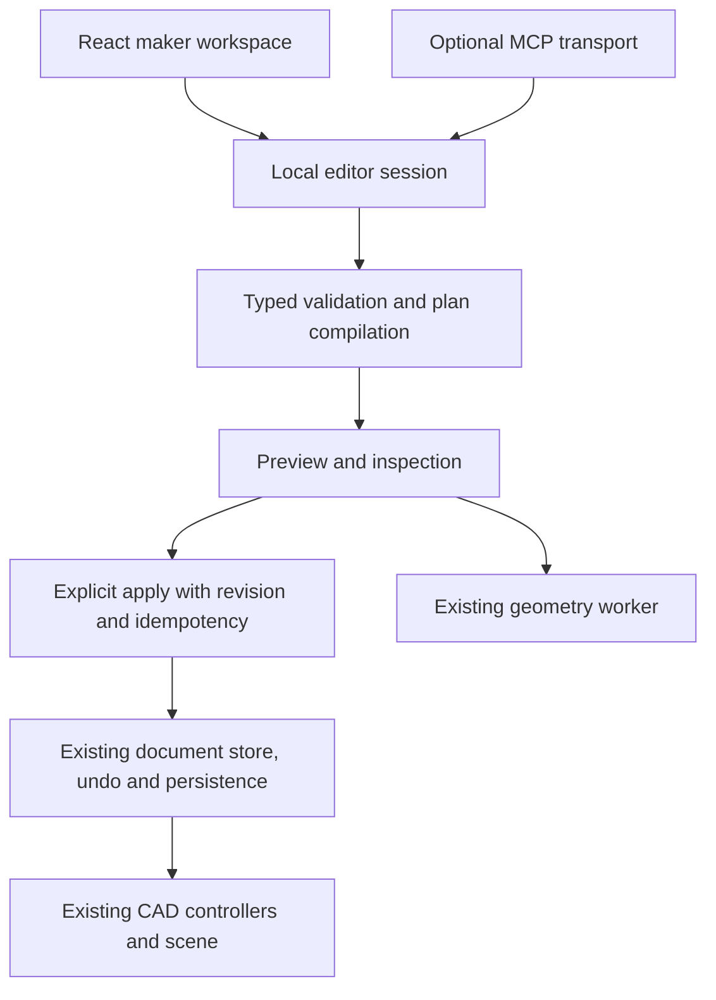

# React workspace migration decision

## Decision and scope

Adopt React and shadcn for the product-owned maker/AI workspace incrementally.
Keep the existing CAD editor, geometry workers, document store, native feature
nodes and MCP transport. This delivery updates the editor source to 2.7.4 and
prepares this plan; it does not install React or start a framework rewrite.

The product direction is sound: constrained generators can help a beginner make
something useful, then the CAD editor can refine it. More generators should be
added when they solve a measured task, rather than making every manual tool an AI
feature. React improves UI composition and reuse; it does not improve geometric
correctness, printer fit, AI reliability or onboarding by itself.

Creation must remain usable without an AI client. Signed-in external clients are
useful for assisted modeling, but their setup is still a separate beginner
friction to address. Never collect provider API keys in the application.

## Alternatives and evidence

| Option | Benefit | Cost and limitation | Decision |
| --- | --- | --- | --- |
| Extract controllers and keep vanilla DOM | Smallest immediate change; no new runtime | Repeated stateful controls still require manual composition, cleanup and accessibility work | Useful first step |
| React island for the maker workspace | Reusable accessible controls; independent workflow development; preserves upstream update path | Two UI technologies during migration; strict DOM and styling ownership required | Recommended |
| Rewrite the whole editor in React | One presentation framework | Rebuilds gesture, picking, canvas and tool lifecycle integrations; makes each upstream file adaptation harder; no inherent CAD benefit | Defer |

The supplied 2.7.4 archive adds Architect, CAM, CosForge, Voxel Studio and more
manual tools as imperative JavaScript modules. A file-level three-way comparison
against the pinned author baseline preserved our native geometry, roles,
persistence and MCP fixes. Only the shared mode switch needed a text conflict
resolution. This is evidence for retaining the editor boundary, not proof that
all upstream behavior is regression-free.

Reconsider a broader presentation migration if author updates stop being useful,
multiple workflows require shared application state that cannot be exposed
cleanly, or measured maintenance cost exceeds the cost of porting and verifying
those specific editor areas. Do not make that decision merely to use components.

## Runtime and ownership

There is one canonical CAD document, revision source, undo stack and persistence
owner. React owns drafts and view state, not a second CAD document. The existing
manual editor remains another document client. Shared commands enforce safety;
disabled UI controls are not the safety boundary.

First extract the local request dispatcher from `mcp/browser/editor-bridge.js`
into an editor-session adapter. It must be available in process independently of
MCP's localhost opt-in and polling lifecycle. Keep HTTP/stdio in the optional MCP
adapter. A local generator must not require a connected AI client or a round trip
through the broker.

The session should expose a small contract:

- `getSnapshot()` returns a cached, immutable summary with revision, document ID,
  relevant body/selection metadata, busy state and capability availability.
- `subscribe(listener)` returns an unsubscribe function and notifies on relevant
  document and session changes, including manual edits, loads and undo.
- `request(action, input)` uses the existing validated command path. Keep preview
  identifiers, current revisions, idempotency, requirements and explicit apply.
- Preview ownership has explicit replace/dispose operations. A result from an old
  draft or revision must not become the current review or be applied silently.

Do not return the mutable `store.doc` directly from a React external-store hook.
Do not clone the entire document on every snapshot read. Document/selection
updates currently also occur through controller paths, so characterize those
before exposing a session subscription. Mesh arrays and pointer-frequency scene
updates stay outside React state.

## UI and build boundary

Keep esbuild, the existing static site and the same local server. No Next.js,
server rendering, new backend or extra service is required. Add React/ReactDOM
and the minimum shadcn dependencies only in the migration delivery.

Put product presentation in `src/ai-workspace/`; keep transport/editor adapters in
`mcp/browser/` and schemas and pure plan logic in `mcp/shared/`. Extract pure
Gridfinity draft/layout controllers before changing their rendering.

React owns a dedicated mount subtree. Existing controllers own everything
outside it. Never let React and a legacy DOM renderer mutate the same children.
Wrap the existing WebGL preview as an imperative widget with a ref, lifecycle
cleanup and resize handling. Do not recreate its renderer on every field change.
Dispatch apply/save commands from user events, never render or mount effects.

Use shadcn primitives for fields, buttons, toggle groups, dialogs, disclosure and
tooltips. Keep dimension steppers, drawer drawing, opening diagrams and geometric
review as product-specific controls. shadcn does not replace UX design or CAD
interaction design. Map its theme to the existing app variables and
`mcp/tokens/ai-status.json`; isolate Tailwind resets and portal containers so
legacy tool styles do not change. Maintain light, dark and contrast themes,
keyboard parity, reduced motion and narrow layouts.

## Staged delivery and rollback

1. **Stabilize 2.7.4**. Verify native model editing, existing projects, generator
   previews, persistence, exports and MCP transaction invariants. Record the
   supplied archive identity; keep dependency versions pinned.
2. **Extract the session and pure controllers**. Keep the current UI and prove
   behavior parity. Test subscriptions, revisions, preview disposal and manual
   edits. This is independently useful without React.
3. **Port Single part as the first React island**. Use a stable sibling mount
   within the workspace; leave the drawer renderer intact. Verify insert/bin/
   baseplate options, units, validation, loading, stale results, review, apply,
   undo and success. Retain a renderer switch until parity is demonstrated.
4. **Port Drawer layout**. Reuse the pure controller, including selection,
   duplication, rotation, resize, drawing, open sides, fill gaps, local undo,
   keyboard alternatives, saves and document reconciliation. Test pointer cancel,
   focus restoration, narrow widths and enlarged text.
5. **Port the workspace shell, connection and settings**, then remove the old
   renderers after parity. Shared controls replace temporary dual implementations.
   Do not keep two independent sources for settings or model defaults.

Each stage must build and run contract/browser tests, required UI gates with
`DS_REQUIRE_BROWSER=1`, and rendered interaction checks. A missing browser is a
failed verification, not a pass. Compare equivalent outputs and transaction
behavior rather than component snapshots. Measure bundle size and startup cost
against this version before choosing lazy loading.

Rollback the renderer or mount flag for the affected stage. Keep document and
plan formats compatible throughout, so returning to the legacy renderer does not
lose drafts or saved models. Avoid concurrent schema and renderer migrations.

## Generator growth

After the first two workflows work well, add a small built-in generator registry
with ID, label, pictogram, component, draft validation and typed plan builder.
Share measured sizing, printer checks, review and explicit Add to document.
Avoid a generic JSON-form builder or arbitrary executable plugins before a
concrete feature needs them.

New manual tools are not automatically supported MCP generators. Architect uses
its own plan data; CosForge and Voxel include mesh-based outputs. Add AI exposure
only through bounded typed schemas, cost limits, native/mesh capability labels,
inspection and explicit apply. Never describe a mesh conversion as analytically
editable native CAD or a geometric check as guaranteed physical printer fit.

## Progress — 2026-10-26

The author has stopped improving the editor interface, so author updates are now
ported for the editor core only (kernel, sketcher, regions, document store,
workers and geometry fixes). Interface changes in the author source are
reference material. The product-owned interface moves to React.

Drawer layout was ported first, ahead of Single part, because it was the most
reported pain point:

- `mcp/browser/ui/drawer-planner.js` is the pure draft controller (stage 2 for
  this workflow). It owns the draft, local undo, preview, apply and document
  reconciliation, and has Node tests in `mcp/tests/drawer-planner.test.mjs`.
- `mcp/browser/ui/drawer-panel.jsx` renders it through `useSyncExternalStore`.
  Store notifications commit synchronously so chained user events see current
  controls, as the DOM renderer did.
- `mcp/browser/ui/controls.jsx` holds the shared pictogram label, number field,
  magnet, open-side, dimension-guide and preview-view controls.
- React 19.3.1, React DOM 19.3.1 and scheduler 0.28.0 production builds are
  pinned in `third_party/`; `react-build.mjs` supplies the esbuild aliases.

Differences from the stages above: the legacy drawer renderer was removed
without a renderer switch after the unchanged drawer browser tests passed, so
rollback is a commit revert. The editor-session adapter and shadcn are not
adopted yet. The drawer keeps the existing `request`/`subscribe` bridge, and the
components reuse the existing CSS classes and tokens.

## Progress — 2026-10-27

- Single part and printer settings are ported. `mcp/browser/ui/part-planner.js`
  is the pure Single part store (Node tests in `mcp/tests/part-planner.test.mjs`)
  and `mcp/browser/ui/template-panel.jsx` mounts one React root for the whole
  workspace. The DOM control duplicates are gone; both workflows use
  `controls.jsx`.
- Single part moved out of the AI workspace into the editor's Gridfinity part
  dialog (`src/gridfinity-part.jsx`), which renders the shared `PartForm`
  from `mcp/browser/ui/part-form.jsx`. The workspace keeps Drawer layout and
  Printer & settings; the dialog reads the saved printer area for its fit check.
- `mcp/browser/` is grouped by role: `ui/` for React components, stores,
  pictograms and CSS; `plans/` for typed plan builders; `inspection/` for
  geometry checks. Editor adapters and the preview viewer stay at the root.
- `plans/model-plan.js` keeps primitive, sketch and feature handling and the
  shared build loop. Each operation type has its own module in
  `plans/operations/` with `normalize` and `build` (and `check` for imports),
  registered in `plans/operations/index.js`. Input validation helpers are in
  `plans/plan-input.js` and transform math in `plans/plan-geometry.js`.
- The beginner ribbon is React (`src/beginner-ribbon.jsx`). Tools sit in titled
  sections like the advanced ribbon: Edit, Create, Combine, Arrange, Modify,
  Check and Workshops. Sections that do not fit fold into a menu instead of
  scrolling; `src/beginner-ribbon-layout.js` decides which. Layerling
  (AGPL-3.0) informed the grouping only; no code was taken from it.
- Selecting a body of a saved parameter model (`mcpModels`, made by the AI)
  shows a Model settings card in the viewport, in every mode. Its independent
  parameters are editable and derived ones are read-only; Preview and Apply use
  the same `preview_parameters` and `apply_model` calls as the agent. A model
  moved or edited by hand is reported instead of regenerated. The store is
  `mcp/browser/ui/parameter-planner.js`; the card is `parameter-card.jsx`.
- The beginner ribbon has a Parts section: Fastener, Gear, Name plate, Knurled
  knob and Coil spring. The dialogs are the community build 23 (MIT) modules,
  also listed in the advanced "Advanced Create" menu; see `SOURCES.md`.

## Documentation grounding

- [React: add React to an existing project](https://react.dev/learn/add-react-to-an-existing-project)
  supports incrementally owning a portion of an existing page.
- [React: useSyncExternalStore](https://react.dev/reference/react/useSyncExternalStore)
  specifies subscriptions and stable immutable snapshots for existing stores.
- [shadcn: manual installation](https://ui.shadcn.com/docs/installation/manual)
  describes its React and styling dependencies; it is not a framework-independent
  CSS skin for the current DOM builders.
